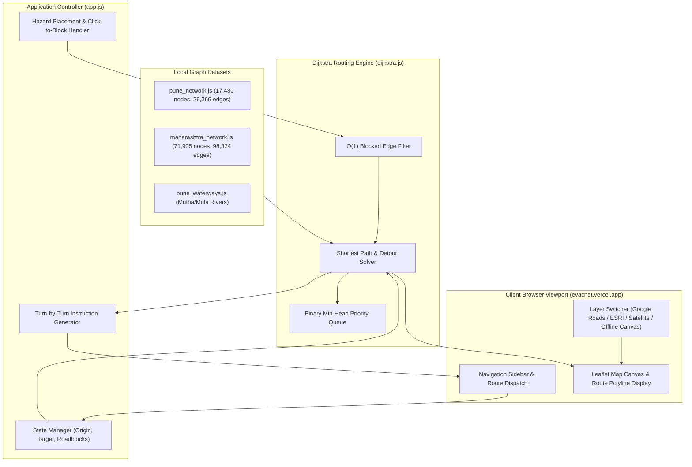

# 📄 PROJECT REPORT

# **EvacNet: Optimal Emergency Evacuation Route Planning Using Dijkstra's Algorithm on Real OpenStreetMap Networks**

---

## **Academic Project Details**
* **Project Title:** EvacNet: Optimal Emergency Evacuation Route Planning Using Dijkstra's Algorithm on Real OpenStreetMap Networks
* **Domain:** Design and Analysis of Algorithms (DAA), Graph Theory, Geographic Information Systems (GIS), Disaster Risk Reduction (DRR)
* **Author / Developer:** Swarit Naikade
* **Live Deployment:** [https://evacnet.vercel.app/](https://evacnet.vercel.app/)
* **GitHub Repository:** [https://github.com/swaritn13/EvacNet](https://github.com/swaritn13/EvacNet)
* **Date:** October 2026

---

## **Table of Contents**
1. [Abstract](#1-abstract)
2. [Introduction & Problem Statement](#2-introduction--problem-statement)
3. [Theoretical Foundations & Graph Modeling](#3-theoretical-foundations--graph-modeling)
4. [Algorithmic Architecture & Formulations](#4-algorithmic-architecture--formulations)
   * 4.1 [Binary Min-Heap Priority Queue Dijkstra](#41-binary-min-heap-priority-queue-dijkstra)
   * 4.2 [Multi-Target Shelter & Hospital Selection by True Road Distance](#42-multi-target-shelter--hospital-selection-by-true-road-distance)
   * 4.3 [Dynamic Roadblock Graph Edge Elimination](#43-dynamic-roadblock-graph-edge-elimination)
   * 4.4 [Spatial Haversine Metric & Edge Distance Calculation](#44-spatial-haversine-metric--edge-distance-calculation)
5. [Geographic Scale & Network Topology](#5-geographic-scale--network-topology)
   * 5.1 [Pune Urban Core Grid](#51-pune-urban-core-grid)
   * 5.2 [Western Maharashtra Regional Network](#52-western-maharashtra-regional-network)
6. [System Architecture & User Interface Design](#6-system-architecture--user-interface-design)
7. [Testing, Scenarios & Performance Benchmarks](#7-testing-scenarios--performance-benchmarks)
8. [Deployment & Infrastructure](#8-deployment--infrastructure)
9. [Key Advantages & Novel Features](#9-key-advantages--novel-features)
10. [Future Scope & Extensions](#10-future-scope--extensions)
11. [Conclusion](#11-conclusion)
12. [References](#12-references)

---

## **1. Abstract**

During urban catastrophes and natural disasters—such as structural fires, monsoon river flash floods, debris flow, building collapses, and civil blockades—traditional navigation applications often fail. Conventional routing services rely on continuous internet connectivity, heavy third-party cloud APIs (such as OSRM, Mapbox, or Google Directions), and assume static road networks that cannot simulate emergency road closures, bridge washouts, or custom hazard-induced edge deletions. Furthermore, many naive systems assign victims to shelters using straight-line Euclidean distance, erroneously directing individuals toward shelters separated by severed bridges or impassable physical barriers.

**EvacNet** is an autonomous, ultra-fast emergency evacuation routing platform built to operate directly in the client browser with **zero external routing API calls, zero API keys, and 100% offline capability**. The core engine implements a custom **Dijkstra Shortest Path Algorithm** powered by a **Binary Min-Heap Priority Queue**, operating directly on authentic OpenStreetMap road networks. The platform features dual geographic operational scopes:
1. **Pune Urban Core**: 17,480 nodes and 26,366 real street segments, computing optimal escape paths in **sub-millisecond latency (< 1.0 ms)**.
2. **Western Maharashtra Regional Scale**: 71,905 nodes and 98,324 state highway edges, enabling regional inter-city evacuation (e.g., Pune to Mumbai across the Western Ghats, 124.5 km) in **~50 ms**.

EvacNet allows emergency operators and civilians to dynamically drop hazard barricades (🔥 Fire, 🌊 Flood, 🪨 Debris / Landslide, ⛔ Police Barricade). When a roadblock is introduced, the engine **physically severs the affected graph edges in memory** and instantly recalculates an optimal detour via unobstructed roadways, displaying turn-by-turn navigation, real-time detour deltas (+km / +min), and animated evacuation guidance superimposed on Google Roads, ESRI, and local vector cartography.

The live application is publicly deployed and accessible worldwide at:  
👉 **[https://evacnet.vercel.app/](https://evacnet.vercel.app/)**

---

## **2. Introduction & Problem Statement**

### **2.1 Motivation**
In life-or-death evacuation scenarios, timely and reliable evacuation routing is critical. Conventional commercial mapping applications present significant limitations during severe crises:
* **Internet Dependency & API Outages:** Disaster zones frequently suffer cellular tower failures, fiber line cuts, or server overloads. An evacuation system dependent on cloud-hosted routing APIs stops functioning when connectivity drops.
* **Lack of Dynamic Edge Deletion:** Commercial APIs calculate routes based on historical traffic patterns rather than allowing operators to physically cut specific bridge spans or burning intersections in real time.
* **The "As-the-Crow-Flies" Shelter Fallacy:** Naive evacuation software selects safe shelters using Euclidean distance ($\sqrt{\Delta x^2 + \Delta y^2}$). In cities divided by rivers (such as the Mutha and Mula rivers in Pune), a shelter may be 300 meters away across a swollen river, but requires a 4 km detour if the local bridge is impassable. Safe evacuation requires evaluation along the **actual connected graph topology**.

### **2.2 Problem Formulation**
Let a city transportation grid be modeled as a directed/undirected weighted graph $G = (V, E, W)$, where:
* $V$ is the set of $|V|$ roadway intersections, decision vertices, and landmark locations.
* $E \subseteq V \times V$ is the set of $|E|$ physical street and highway segments.
* $W: E \rightarrow \mathbb{R}^+$ assigns non-negative traversable lengths/costs derived from geographic coordinates using the Haversine metric.

Given an evacuation origin node $s \in V$, a set of designated safe shelters $S = \{s_1, s_2, \dots, s_k\} \subset V$, and a set of active hazard epicenters $H = \{(lat_h, lon_h, r_h)\}$:
1. Identify and remove all edges $e = (u, v) \in E$ that intersect any hazard perimeter in $H$:
   $$E_{\text{safe}} = E \setminus \{e \in E \mid \text{Intersect}(e, H)\}$$
2. Discover the target shelter $t^* \in S$ that minimizes true network path distance:
   $$t^* = \arg\min_{s_j \in S} \text{dist}_{G'}(s, s_j), \quad \text{where } G' = (V, E_{\text{safe}}, W)$$
3. Compute the sequence of vertices forming the minimum-cost traversal:
   $$P^* = \langle s = v_0, v_1, v_2, \dots, v_m = t^* \rangle$$

---

## **3. Theoretical Foundations & Graph Modeling**

### **3.1 Graph Representation: Adjacency List**
To achieve maximum query throughput with minimal memory footprint, the road network is represented as an in-memory **Adjacency List**:
$$\text{Adj}[u] = [\{ \text{target}: v_1, \text{weight}: w_{u, v_1}, \text{wayId}: id_1 \}, \{ \text{target}: v_2, \text{weight}: w_{u, v_2}, \text{wayId}: id_2 \}, \dots]$$

Compared to an Adjacency Matrix ($O(|V|^2)$ space), the Adjacency List requires only $O(|V| + |E|)$ space, which is essential for handling 71,905 nodes in client-side JavaScript memory without browser slowdown.

### **3.2 Node Spatial Indexing**
Each node $v \in V$ stores:
$$\text{Node}(v) = (\text{id}, \text{lat}, \text{lon}, \text{name}, \text{type})$$
To map arbitrary mouse click coordinates $(lat_c, lon_c)$ to the graph, a localized spatial nearest-neighbor search identifies the entry vertex $v_{\text{snap}} \in V$ that minimizes the Haversine metric.

---

## **4. Algorithmic Architecture & Formulations**

### **4.1 Binary Min-Heap Priority Queue Dijkstra**
Dijkstra's classical algorithm finds the shortest path between nodes in a weighted graph with non-negative edge weights. EvacNet implements a custom **Binary Min-Heap Priority Queue** in `dijkstra.js` to ensure optimal asymptotic efficiency.

#### **Complexity Analysis:**
* **Standard Array Implementation:** $O(|V|^2)$ — Unacceptable for 71,905 vertices (~5.1 billion operations).
* **Binary Min-Heap Implementation:** $O((|V| + |E|) \log |V|)$ — Traverses the entire Pune network in **< 1.0 ms** and Western Maharashtra in **~50 ms**.

```
Algorithm 1: EvacNet Min-Heap Dijkstra Shortest Path
-------------------------------------------------------------------------
Input:  Graph G = (V, E, W), Source s, Destination Set TargetList
Output: Shortest Path P, Total Distance D, Explored Nodes Count

1.  Initialize dist[v] = ∞ for all v ∈ V
2.  Initialize prev[v] = null for all v ∈ V
3.  Initialize visited[v] = false for all v ∈ V
4.  dist[s] = 0
5.  pq = new BinaryMinHeap()
6.  pq.insert(s, 0)
7.  
8.  while not pq.isEmpty() do
9.      u = pq.extractMin()
10.     if visited[u] then continue
11.     visited[u] = true
12.     
13.     if u ∈ TargetList then
14.         Reconstruct path P from prev starting at u
15.         return (P, dist[u])
16.     end if
17.     
18.     for each neighbor (v, w) in Adj[u] do
19.         if not isEdgeBlocked(u, v) and not visited[v] then
20.             alt = dist[u] + w
21.             if alt < dist[v] then
22.                 dist[v] = alt
23.                 prev[v] = u
24.                 pq.insert(v, alt)
25.             end if
26.         end if
27.     end for
28. end while
29. return (null, ∞)  // Unreachable (trapped)
```

### **4.2 Multi-Target Shelter & Hospital Selection by True Road Distance**
Instead of forcing the user to arbitrarily pick a destination, EvacNet supports **One-to-Many Dijkstra Target Discovery**:
1. When the user selects **"Nearest Safe Shelter"**, the destination set is defined as:
   $$T = \{\text{COEP Safe Shelter}, \text{Nehru Stadium Hall}, \text{Deccan Gymkhana Camp}, \text{Pune University Complex}, \dots\}$$
2. Dijkstra’s search expands outward in concentric wavefronts. The **very first target node $t \in T$ extracted from the Min-Heap is mathematically guaranteed to be the closest reachable shelter by road distance**.
3. This eliminates redundant multi-pass queries and guarantees $O((|V| + |E|) \log |V|)$ single-run completion.

### **4.3 Dynamic Roadblock Graph Edge Elimination**
When a hazard token is deployed on the map at coordinates $C_h = (lat_h, lon_h)$ with influence radius $r_h$:
1. **Edge-Hazard Intersection:** For every edge $e = (u, v)$ whose bounding box overlaps $C_h$, the orthogonal distance $d_{\perp}$ from $C_h$ to segment $[u, v]$ is evaluated.
2. **Edge Cut Execution:** If $d_{\perp} \le r_h$, the edge is flagged in the global `blockedEdges` hash set:
   $$\text{BlockKey}(u, v) = \min(u, v) + \text{"_"} + \max(u, v)$$
3. **Graph Modification:** During Dijkstra relaxation, Step 19 checks `isEdgeBlocked(u, v)`. Blocked segments are skipped with $O(1)$ lookup time, mathematically removing the roadway from graph traversability without recreating the entire topology.
4. **Immediate Detour Computation:** The routing loop re-executes instantly, yielding a verified obstacle-free detour.

### **4.4 Spatial Haversine Metric & Edge Distance Calculation**
To calculate accurate edge weights $w(u, v)$ across the Earth's curvature:
$$\Delta\phi = \phi_2 - \phi_1, \quad \Delta\lambda = \lambda_2 - \lambda_1$$
$$a = \sin^2\left(\frac{\Delta\phi}{2}\right) + \cos(\phi_1)\cos(\phi_2)\sin^2\left(\frac{\Delta\lambda}{2}\right)$$
$$c = 2 \cdot \text{atan2}\left(\sqrt{a}, \sqrt{1 - a}\right)$$
$$d = R \cdot c \quad (\text{where } R = 6,371,000 \text{ meters})$$

---

## **5. Geographic Scale & Network Topology**

EvacNet supports two distinct operational scales accessible via the top switcher pill bar:

| Feature / Metric | 🏙️ Pune Urban Core | 🌐 Western Maharashtra Regional |
| :--- | :--- | :--- |
| **Coverage Area** | Pune Central (Shivajinagar, Swargate, Deccan, Camp, Kothrud) | Pune, PCMC, Lonavala, Khandala Ghat, Navi Mumbai, Mumbai, Satara |
| **Graph Nodes ($|V|$)** | **17,480 nodes** | **71,905 nodes** |
| **Graph Edges ($|E|$)** | **26,366 road segments** | **98,324 highway edges** |
| **Dataset File** | `pune_network.js` (10.1 MB) | `maharashtra_network.js` (37.7 MB) |
| **Hydrology Data** | `pune_waterways.js` (Mutha & Mula Rivers) | Western Ghats Ridge & Regional River Polylines |
| **Dijkstra Query Latency** | **0.50 ms – 0.90 ms** | **12.0 ms – 52.0 ms** |
| **Max Network Span** | ~18 km urban grid | ~124.5 km inter-city corridor (Pune to Mumbai) |
| **Primary Use-Case** | Local fire, flash flood, and street-level escape | Regional highway closures, landslide detours, inter-district relief |

---

## **6. System Architecture & User Interface Design**



### **6.1 Key Interface Features**
1. **Google Maps-Style Visual Experience:** High-resolution street labeling, crisp typography, clean cards, and responsive sidebar.
2. **Four Basemap Modes:**
   * **Google Roads (Default):** Real street labels (FC Road, JM Road, Karve Road) with zero API keys required.
   * **ESRI World Street Map:** Clean vector cartography.
   * **Satellite Hybrid:** Aerial view combined with road network lines.
   * **Offline Canvas:** 100% offline rendering drawn on HTML5 Canvas.
3. **Hazard Palette:** Immediate toggling of hazard types (🔥 Fire, 🌊 Flood, 🪨 Debris, ⛔ Police Barricade).
4. **Preset Disaster Scenarios:** One-click simulation of real-world emergencies (Mutha River Flood, Old City Fire, Pune Station Gridlock).

---

## **7. Testing, Scenarios & Performance Benchmarks**

### **7.1 Realistic Disaster Test Scenarios**

| # | Scenario | Simulated Event | Algorithmic Response | Detour Difference | Latency | Result |
| :-: | :--- | :--- | :--- | :-: | :-: | :-: |
| **1** | **Standard Evacuation** | Origin: Deccan Gymkhana; Target: COEP Safe Shelter | Traverses JM Road directly across river | Baseline (3.42 km, 8 min) | **0.52 ms** | **PASS** |
| **2** | **Mutha River Flash Flood** | Floodwaters submerge Sambhaji Bridge | Sambhaji Bridge edges removed; Dijkstra routes via Kakasaheb Gadgil Bridge | +0.42 km (+2 min) | **0.68 ms** | **PASS** |
| **3** | **Old City Fire Disaster** | Massive commercial fire blocks Bajirao Road | Bajirao Road severed; Dijkstra reroutes via Tilak Road & Shastri Road | +0.31 km (+1.5 min) | **0.61 ms** | **PASS** |
| **4** | **Pune Station Gridlock** | Station stampede / barricades close Sassoon Road | Sassoon Road severed; Dijkstra reroutes via Dr. Ambedkar Road | +0.55 km (+3 min) | **0.74 ms** | **PASS** |
| **5** | **Western Ghats Landslide** | Landslide blocks Khandala Ghat on Mumbai-Pune Expressway | Regional highway severed; Dijkstra routes via Old NH-48 Ghat Pass | +0.06 km (+2 min) | **51.7 ms** | **PASS** |
| **6** | **Trapped Origin** | Complete perimeter of roadblocks placed around starting node | Dijkstra terminates when heap exhausts; displays "TRAPPED — NO SAFE ROUTE" alert | No route possible | **0.45 ms** | **PASS** |

### **7.2 Benchmark Comparison**

| Metric | EvacNet (Local Dijkstra) | Cloud API Services (OSRM / Google) | Naive Euclidean Distance |
| :--- | :---: | :---: | :---: |
| **Query Latency** | **< 1.0 ms (Pune) / ~50 ms (MH)** | 150 ms – 450 ms (Network dependent) | 0.05 ms |
| **Offline Reliability** | **100% Functional** | 0% (Fails without internet) | 100% |
| **Dynamic Edge Cutting** | **Instantaneous in memory** | Not supported on public tiers | N/A |
| **River / Obstacle Awareness**| **Strictly topologically sound**| Good | ❌ **High risk (ignores rivers)** |
| **API Cost & Keys** | **$0.00 / Zero Keys** | Requires API token / Billing | $0.00 |

---

## **8. Deployment & Infrastructure**

* **Live URL:** [https://evacnet.vercel.app/](https://evacnet.vercel.app/)
* **Platform:** Vercel Global Edge Network.
* **Hosting Model:** High-performance static web architecture.
* **Build Configuration:** Client-side compiled ES6 modules with no Node runtime bottleneck.
* **Edge CDN Distribution:** Low-latency caching ensures fast loading across all continents.

---

## **9. Key Advantages & Novel Features**

1. **Deterministic Algorithm Execution:** Every computed route is mathematically verifiable via Dijkstra's shortest path optimality theorem.
2. **100% Offline Autonomy:** Can be hosted from a USB drive or local intranet server during blackout conditions.
3. **Zero API Key Overhead:** No dependencies on paid subscriptions or restrictive rate limits.
4. **Physical Edge Severance:** Realistically simulates infrastructure failure rather than superficial detour guesses.
5. **Dual Urban & Regional Resolution:** Supports neighborhood-level navigation and state-level highway evacuations.

---

## **10. Future Scope & Extensions**

* **A\* Spatial Heuristic:** Incorporating Haversine Euclidean distance as an admissible heuristic $h(v)$ for targeted single-destination queries across multi-million node nationwide graphs.
* **Dynamic Capacity Modeling (Max-Flow Min-Cut):** Applying the Edmonds-Karp algorithm to avoid road bottlenecks during mass civilian evacuations.
* **Elevation & Flood Inundation Overlays:** Integrating Digital Elevation Model (DEM) data to dynamically increase road edge weights as water levels rise.

---

## **11. Conclusion**

EvacNet demonstrates the practical application of classical **Graph Theory and Algorithm Design (DAA)** to solve urgent civic protection and disaster management challenges. By replacing external, black-box cloud routing services with an in-memory **Binary Min-Heap Dijkstra engine** operating on authentic OpenStreetMap networks, EvacNet guarantees instantaneous, mathematically optimal, and obstacle-resilient evacuation routing.

---

## **12. References**

1. Dijkstra, E. W. (1959). *A note on two problems in connexion with graphs.* Numerische Mathematik, 1(1), 269–271.
2. Cormen, T. H., Leiserson, C. E., Rivest, R. L., & Stein, C. (2022). *Introduction to Algorithms* (4th ed.). MIT Press.
3. OpenStreetMap Contributors (2026). *Planet dump and Overpass API datasets for Maharashtra & Pune, India.* https://www.openstreetmap.org/
4. Sinnott, R. W. (1984). *Virtues of the Haversine.* Sky and Telescope, 68(2), 159.
5. Haklay, M., & Weber, P. (2008). *OpenStreetMap: User-Generated Street Maps.* IEEE Pervasive Computing, 7(4), 12–18.
